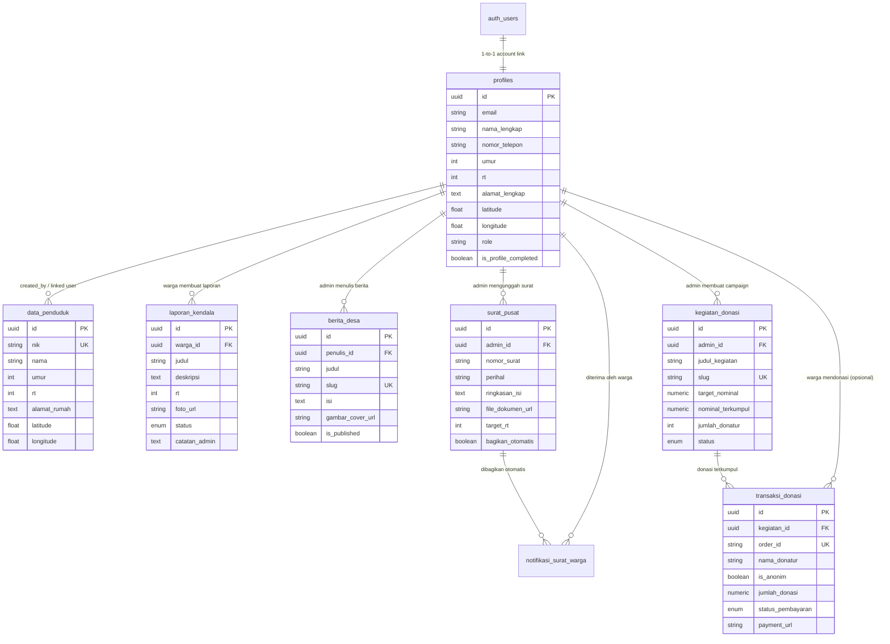

# 🗄️ Dokumentasi Struktur Database - Sakalputung

Dokumentasi ini menjelaskan rancangan skema database untuk web **Layanan Publik Desa Sakalputung** berbasis **Supabase (PostgreSQL)** sesuai spesifikasi di file [ROAD.md](../ROAD.md).

---

## 📌 Gambaran Umum Relasi (Entity Relationship)

---

## 📋 Detail Tabel & Kebutuhan Fitur

### 1. `profiles`
* **Kegunaan**: Menyimpan informasi akun user (Warga dan Admin RT 1-5). Terhubung dengan `auth.users` Supabase.
* **Fitur yang Didukung**:
  * Autentikasi Google / Nomor Telepon (`auth.users`).
  * Onboarding profil awal warga (`is_profile_completed`): nama, umur, RT (1-5), alamat lengkap.
  * Role: `'warga'`, `'admin_rt'`, `'admin_desa'`.
  * Koordinat alamat rumah (`latitude`, `longitude`) untuk pemetaan maps.

### 2. `data_penduduk`
* **Kegunaan**: Master kependudukan desa Sakalputung untuk RT 1 sampai RT 5.
* **Fitur yang Didukung**:
  * Menampilkan data kependudukan desa (nama, umur, RT 1-5).
  * Pemetaan alamat seluruh rumah penduduk melalui Leaflet/Google Maps (`latitude`, `longitude`).

### 3. `laporan_kendala`
* **Kegunaan**: Menyimpan keluhan/pengaduan dari warga desa.
* **Fitur yang Didukung**:
  * Upload foto kendala dan deskripsi keluhan.
  * Status pengerjaan oleh admin:
    1. `belum_dikerjakan`
    2. `menunggu_info_lanjut`
    3. `sudah_dikerjakan`
  * Catatan dan nama admin RT yang merespon.

### 4. `berita_desa`
* **Kegunaan**: Mengelola artikel informasi dan pengumuman desa.
* **Fitur yang Didukung**:
  * Admin menambahkan berita desa (judul, slug, cover image, konten).
  * Ditampilkan pada beranda/halaman warga desa.

### 5. `surat_pusat` & `notifikasi_surat_warga`
* **Kegunaan**: Distribusi informasi surat dari instansi pusat ke warga.
* **Fitur yang Didukung**:
  * Admin menginput surat pusat dan file dokumen/PDF.
  * Trigger otomatis mendistribusikan notifikasi (`bagikan_otomatis`) ke seluruh akun warga di RT terkait.

### 6. `kegiatan_donasi` & `transaksi_donasi`
* **Kegunaan**: Forum penggalangan dana sosial desa dan pencatatan transaksi *payment gateway*.
* **Fitur yang Didukung**:
  * Admin membuka forum kegiatan donasi dengan target nominal.
  * Warga/donatur melakukan pembayaran melalui Payment Gateway (QRIS, VA, E-Wallet).
  * Webhook payment gateway mengupdate status pembayaran (`pending` ➔ `berhasil`).
  * Trigger otomatis mengakumulasikan `nominal_terkumpul` dan `jumlah_donatur`.

---

## 🚀 Cara Import ke Supabase

1. Buka dashboard proyek Anda di **[Supabase Console](https://supabase.com/dashboard)**.
2. Buka menu **SQL Editor** pada sidebar kiri.
3. Buka dan salin seluruh isi file **[schema.sql](./schema.sql)**, lalu klik **Run**.
4. (Opsional) Salin dan jalankan isi file **[seed.sql](./seed.sql)** untuk mengisi data dummy awal (Admin RT 1-5, data kependudukan, berita, kegiatan donasi).

---

## 🪣 Konfigurasi Storage Bucket Supabase

Buat bucket berikut di menu **Storage** Supabase:
1. `laporan-images` (Public/Private dengan Policy): Foto bukti laporan kendala warga.
2. `berita-images` (Public): Gambar banner/cover berita desa.
3. `surat-documents` (Authenticated): File dokumen PDF surat dari pusat.
4. `donasi-banners` (Public): Banner forum kegiatan donasi.
